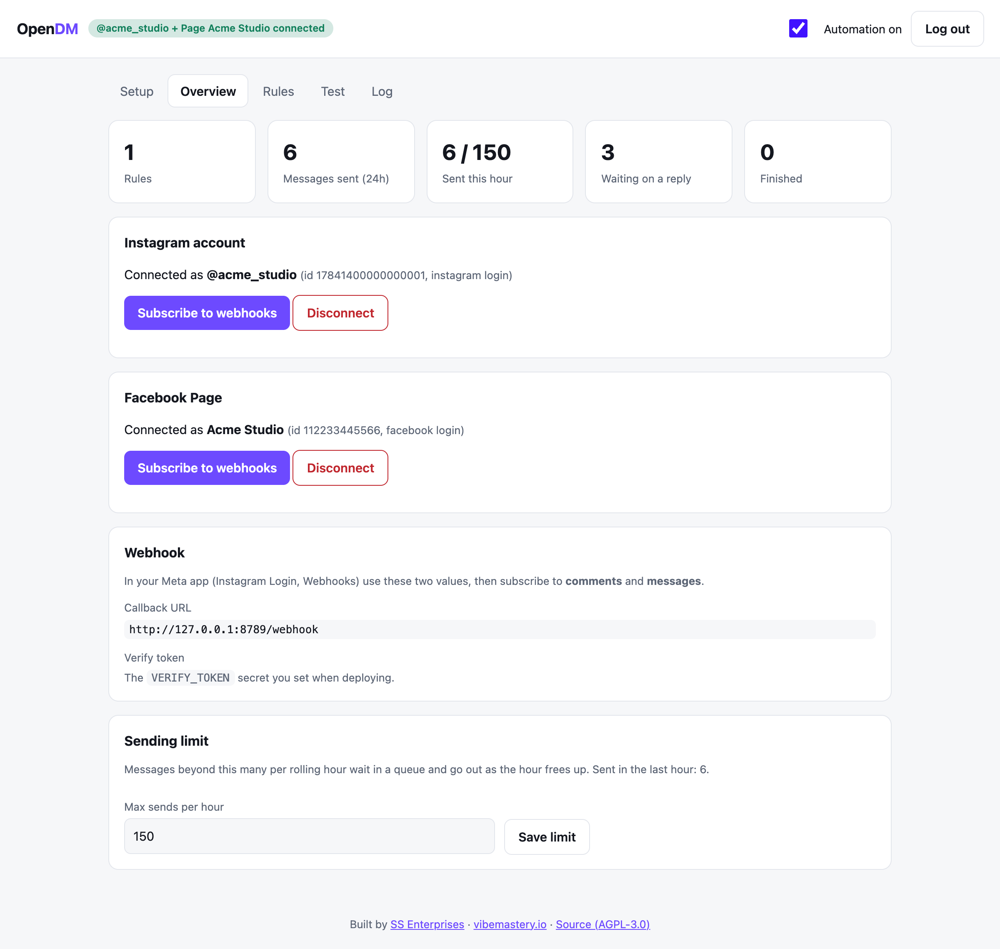
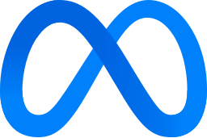
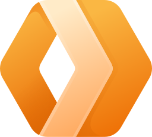
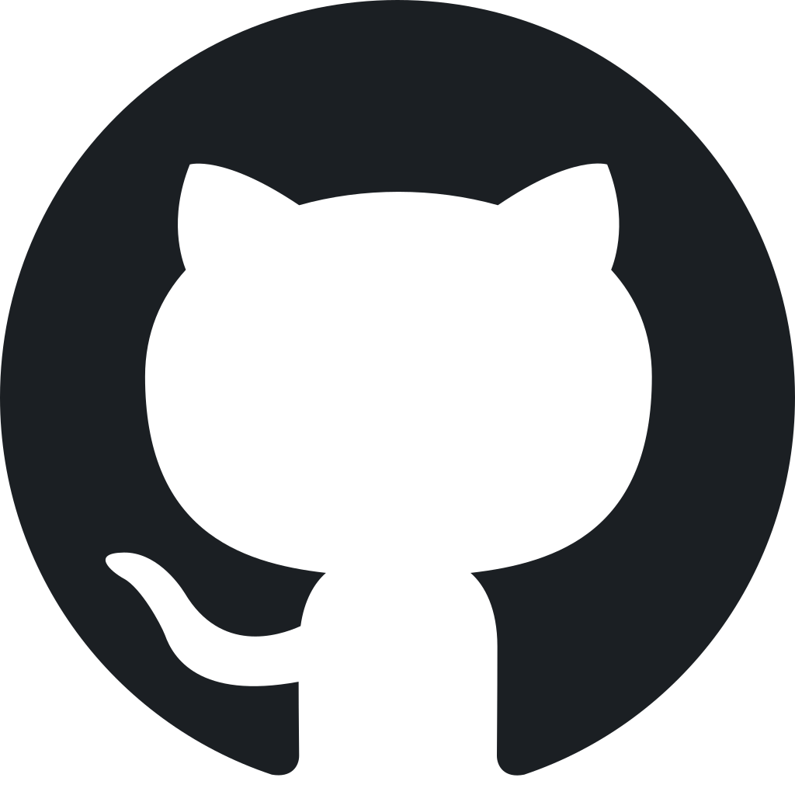
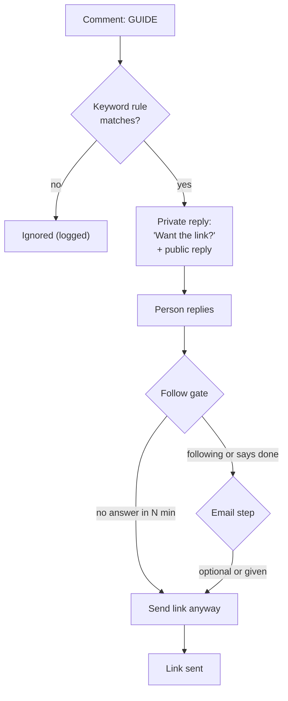
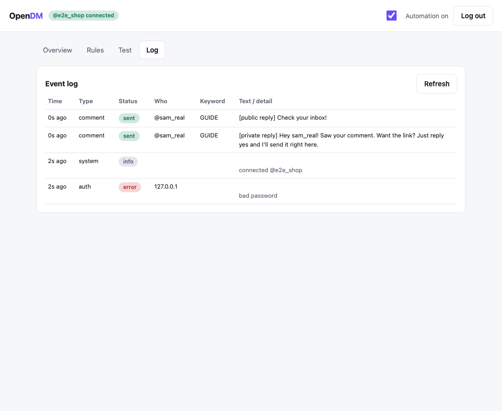
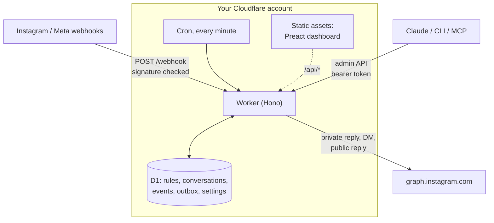

<div align="center">

<picture>
  <source media="(prefers-color-scheme: dark)" srcset="docs/logo-dark.svg">
  
</picture>

### The open-source, self-hosted alternative to ManyChat-style Instagram and Facebook DM automation

Someone comments a keyword on Instagram or Facebook. OpenDM replies, slides into their DMs, asks them to follow, and sends the link.
It runs on **your** Cloudflare account. No monthly bill, no per-contact pricing, no one else holding your data.

[](LICENSE)
[](https://github.com/charanjit-singh/opendm/actions/workflows/ci.yml)
[](https://github.com/charanjit-singh/opendm/stargazers)

[](https://deploy.workers.cloudflare.com/?url=https://github.com/charanjit-singh/opendm)

[**Set it up with your AI agent**](#-set-it-up-with-your-ai-agent) · [How it works](#-how-it-works) · [Manual deploy](#-manual-deploy) · [Docs](#-docs) · [FAQ](#-faq)

<br>



</div>

<p align="center">
  <sub>Works with</sub><br>
  &nbsp;&nbsp;&nbsp;
  &nbsp;&nbsp;&nbsp;
  &nbsp;&nbsp;&nbsp;
  &nbsp;&nbsp;&nbsp;
  <picture>
    <source media="(prefers-color-scheme: dark)" srcset="docs/logos/github-dark.svg">
    
  </picture>
</p>

<p align="center"><sub>Logos belong to their owners and are used only to say what OpenDM works with. OpenDM is not affiliated with or endorsed by any of them. <a href="docs/logos/README.md">Sources</a>.</sub></p>

---

## 🤔 What's Cloudflare? (explained simply)

Cloudflare is a company with computers all over the world. You can rent a tiny piece of them to run your own little robot, and
you can start for free. **OpenDM is that robot.** It lives in your Cloudflare account, watches your Instagram and Facebook
comments, and sends the DMs for you. You own it. Nobody else does.

**Why not just run it on my laptop?** Because a comment can arrive at 3 a.m., and the robot has to answer right away. A laptop
goes to sleep, loses Wi-Fi and gets switched off. Cloudflare's computers never sleep, are always online and are fast everywhere,
so every comment gets its DM even while you're asleep. And you don't have to look after a server.

**What you need:** a free [Cloudflare account](https://dash.cloudflare.com/sign-up), plus your Instagram and/or Facebook account.

**Is it really free?** To start, yes. Cloudflare's free plan currently includes 100,000 Worker requests a day and, for the
database, 5 million rows read and 100,000 rows written a day, with 5 GB of storage
([Workers limits](https://developers.cloudflare.com/workers/platform/pricing/),
[D1 limits](https://developers.cloudflare.com/d1/platform/pricing/)). OpenDM also wakes up once a minute to send queued messages
and tidy up, which is part of that budget. A small account stays well inside it. A very busy account (many thousands of
comments a day) could pass it; on the free plan the database then returns errors until the next daily reset at 00:00 UTC, and
you would move to Cloudflare's paid plan. Check those pages for today's numbers: they can change.

<details>
<summary><b>Words you'll meet (a tiny glossary)</b></summary>

- **Worker**: a small program that Cloudflare runs for you. OpenDM is one Worker.
- **D1**: a little notebook (database) in your Cloudflare account where OpenDM writes down rules, conversations and the log.
- **Webhook**: Instagram or Facebook knocking on OpenDM's door to say "someone just commented!". You tell them the address to knock on.
- **Private reply**: the first DM, sent in answer to a comment. Meta allows one per comment.
- **OAuth ("Connect with Instagram")**: the button that lets you say "yes, OpenDM may act for my account" without sharing your password.
- **Token**: a long secret key that proves OpenDM may act for your account. Keep it private. OpenDM stores it encrypted.
- **MCP**: a standard plug that lets AI assistants like Claude use tools. OpenDM has one, so you can say "make a flow for AUTOMATION" in plain English.
- **Meta app**: the little registration you make with Meta (Instagram's and Facebook's parent company) so they allow OpenDM to connect.
- **App Review**: Meta checking your app before strangers can trigger it. You don't need it to try OpenDM on your own account.

</details>

## 💡 Why OpenDM

- **No monthly bill.** You pay Cloudflare for what you use, which for a typical small account fits in their free tier ([Workers pricing](https://developers.cloudflare.com/workers/platform/pricing/), [D1 pricing](https://developers.cloudflare.com/d1/platform/pricing/)).
- **Your data stays yours.** Comments, conversations and emails live in a D1 database in your own Cloudflare account.
- **Open source, AGPL-3.0.** Read it, change it, self-host it. No black box between you and your audience.
- **Built to be driven by Claude.** An MCP server and CLI ship in the repo, so you can say what you want in plain English.

## ✨ Features

| Feature | What it does |
| --- | --- |
| 🔑 **Keyword triggers** | Case, accents, emoji and small typos ignored. Per-post rules supported. |
| 📸 **Instagram and Facebook** | Instagram (Instagram Login, or through a Facebook Page) and Facebook Pages with Messenger, per rule or both. |
| 💬 **Private + public reply** | A private reply to the comment, plus a public reply. Keyword DMs can start a flow too. |
| 🔁 **Message cycling** | Every message can have several wordings, taken in turns or at random, so nothing looks copy-pasted. The log shows which one went out. |
| 🧭 **Guided onboarding** | A Setup wizard with live checks for the Meta app, OAuth, tokens and webhooks; the same steps in the CLI and for agents. |
| ➕ **Follow gate** | Asks them to follow, checks the follow status when Meta allows it, falls back to "tap done", and sends the link anyway after a timeout. |
| 📬 **Email capture** | Optional or required step before the link. |
| 🚦 **Rate limits and queue** | Rolling hourly cap, outbox in D1, retries with backoff, retried webhooks deduplicated. |
| 🧪 **Dry-run tester** | Simulate a whole conversation, replies and timeouts included, without sending anything. |
| 📜 **Event log** | Every comment seen, message sent, error and skip, with the reason. |
| 🤖 **MCP and CLI control** | A remote MCP server at `/mcp` (29 tools) and an agent-friendly CLI. Fork it and let your agent change the code, or just connect it. |
| 🔒 **Secure by default** | HMAC-verified webhooks, encrypted tokens, password-protected dashboard. |
| 🛠️ **Tiny to run** | One Worker, one D1 database, one cron. The schema creates and upgrades itself. |

## 🧭 How it works



1. **A comment arrives.** Instagram calls your Worker's webhook. The signature is verified and the comment is matched to a rule.
2. **OpenDM replies.** A private reply to the comment (Meta allows one per comment) and a public reply. Their answer opens the 24 hour DM window.
3. **The flow runs.** Follow gate, optional email, then the link. Everything is queued, rate limited and logged.

<p align="center">
  
</p>

## 🤖 Set it up with your AI agent

There are two ways to run OpenDM with an agent such as Claude Code, Codex, Cursor or Gemini CLI. Use either, or both.

### 1. Code-first: fork it and let your agent own it

Fork the repo, log in to Cloudflare, and open it in your agent. It deploys, configures, and can add features to the code.

```sh
git clone https://github.com/<you>/opendm && cd opendm
npx wrangler login          # you approve this in the browser
claude                      # or: codex, cursor, gemini ...
```

The repo teaches the agent: [`AGENTS.md`](AGENTS.md) (works everywhere), [`CLAUDE.md`](CLAUDE.md) and, for Claude Code, the commands
`/deploy`, `/onboard`, `/connect-instagram`, `/add-rule`, `/add-custom-domain` and `/new-feature`, plus two skills.

```text
Deploy this to my Cloudflare account and connect my Instagram. Follow AGENTS.md. Ask me only for things that need me
(logins, the Meta app ID and secret, approvals). Never print secrets.
```

```text
Whenever someone comments AUTOMATION, DM them, ask them to follow me, then send https://example.com/automation-guide.
Use three wordings for the opener and cycle them. Test it before you finish.
```

### 2. MCP: connect any time to a deployed instance

Your Worker serves an MCP endpoint at `/mcp` (Streamable HTTP, authenticated with your admin password). Connect Claude Desktop,
Claude Code or any MCP client and manage everything by asking.

```sh
claude mcp add --transport http opendm https://<your-worker>/mcp --header "Authorization: Bearer <ADMIN_PASSWORD>"
```

29 tools: setup and checks, accounts (Instagram, Facebook Pages), rules and flows, message wordings, dry runs, logs,
conversations, captured emails, queue, settings, health. A stdio server (`node cli/mcp.ts --url ... --token ...`) and an
agent-friendly CLI (`--json`, exit codes, idempotent) are included. Details: [docs/ai-agents.md](docs/ai-agents.md).

<details>
<summary><b>More prompts</b></summary>

```text
Add an optional email step to the AUTOMATION flow, and if they ignore the follow ask, send the link after 30 minutes.
```
```text
Make the Facebook version of that flow too, and also trigger it when someone DMs me the keyword.
```
```text
Pause all automation until Monday.
```
```text
Show me what happened with the last 20 comments. Why did nobody get a DM?
```
```text
Put this on dm.mydomain.com and tell me what to change in the Meta app.
```

</details>

<details>
<summary><b>The CLI</b></summary>

```sh
export OPENDM_URL=https://<your-worker>.workers.dev OPENDM_TOKEN=<ADMIN_PASSWORD>
node cli/opendm.ts setup status --json        # onboarding checklist; exit code 2 = a person has to act
node cli/opendm.ts rule add --keywords AUTOMATION --link https://example.com/guide --follow --channel both
node cli/opendm.ts test "AUTOMATION please" --replies yes,done --following yes
node cli/opendm.ts leads
node cli/opendm.ts help
```

</details>

## 🚀 Manual deploy

### One click

1. Click **Deploy to Cloudflare** at the top. Cloudflare copies the repo to your GitHub, creates the D1 database and asks for three secrets:

   | Secret | What to put |
   | --- | --- |
   | `ADMIN_PASSWORD` | A long password for the dashboard |
   | `SESSION_SECRET` | Random 32+ character string (`openssl rand -hex 32`) |
   | `VERIFY_TOKEN` | Any string you choose, pasted later into Meta's webhook form |

2. Open `https://<your-worker>.workers.dev/` and log in. The **Setup** tab walks you through the Meta app, connecting, and the webhook ([docs/onboarding.md](docs/onboarding.md)).

### From the command line

```sh
git clone https://github.com/charanjit-singh/opendm && cd opendm
npm install
npx wrangler deploy        # builds the dashboard, creates the D1 database
npx wrangler secret put ADMIN_PASSWORD
npx wrangler secret put SESSION_SECRET
npx wrangler secret put VERIFY_TOKEN
```

<details>
<summary><b>Create the Meta app (Instagram and Facebook)</b></summary>

You need an Instagram **Professional** account (Business or Creator). No Facebook Page is needed.

1. Go to [developers.facebook.com/apps](https://developers.facebook.com/apps) and **Create app**. Use case: *Other*, type: *Business*.
2. Add the **Instagram** product and open **API setup with Instagram login**.
   - Copy the **Instagram app secret**. This is `INSTAGRAM_APP_SECRET`.
   - **Add account**: add your Instagram account (accept the tester invite in Instagram under *Settings, Website permissions, Apps and websites, Tester invites*).
   - **Generate token** for it with `instagram_business_basic`, `instagram_business_manage_comments` and `instagram_business_manage_messages`, and paste it in OpenDM under *Overview, Instagram account*.
   - Optional: set `INSTAGRAM_APP_ID` (`npx wrangler secret put INSTAGRAM_APP_ID`) and add `https://<your-worker>.workers.dev/admin/oauth/callback` as an OAuth redirect URI to get a **Connect with Instagram** button.
3. **Configure webhooks** on the same page:
   - Callback URL: `https://<your-worker>.workers.dev/webhook`
   - Verify token: your `VERIFY_TOKEN`
   - Subscribe to the **`comments`** and **`messages`** fields, then click **Subscribe to comments + messages** in OpenDM.
4. Create a rule, try it in the **Test** tab, then comment the keyword from a second account that has a role on the app.

</details>

<details>
<summary><b>Going live: App Review</b></summary>

In development mode the app only serves accounts with a role on it, which is all you need for your own account. To serve the public:

- Switch the app to **Live**. It needs a privacy policy URL: use `https://<your-worker>.workers.dev/privacy`.
- Request **Advanced Access** for the three permissions through **App Review** (screencasts of the comment, private reply and DM flow). Meta usually also asks for **Business Verification** of the company that owns the app.
- Follow Meta's platform rules: message only people who commented or messaged you, no spam, honor opt-outs.

</details>

<details>
<summary><b>Configuration reference</b></summary>

| Name | Kind | Purpose |
| --- | --- | --- |
| `ADMIN_PASSWORD` | secret | Dashboard login, and the bearer token for the CLI and MCP server |
| `SESSION_SECRET` | secret | Cookie signing and token encryption |
| `VERIFY_TOKEN` | secret | Meta webhook verification handshake |
| `INSTAGRAM_APP_ID`, `INSTAGRAM_APP_SECRET`, `FACEBOOK_APP_ID`, `FACEBOOK_APP_SECRET` | optional | The Meta app credentials. Easier to enter in the Setup tab (stored encrypted in D1); a webhook signed by either app is accepted |
| `GRAPH_BASE`, `OAUTH_BASE` | optional | Point the Graph client at a mock (used by the tests) |

Rules, messages, the on/off switch and the hourly cap live in D1 and are edited in the dashboard.

Local development: `cp .dev.vars.example .dev.vars`, then `npm run dev`. To receive real webhooks locally, expose the dev server with `cloudflared tunnel --url http://localhost:8787`.

</details>

## 📚 Docs

| | |
| --- | --- |
| [Onboarding](docs/onboarding.md) | The Meta app, permissions, OAuth, webhooks, App Review, and troubleshooting common Meta errors |
| [Facebook Pages and Messenger](docs/facebook.md) | Setup, differences from Instagram, Instagram through Facebook Login |
| [Message cycling](docs/message-cycling.md) | Several wordings per message and how they rotate |
| [Custom domain](docs/custom-domain.md) | Your own hostname, and what to change in Meta |
| [AI agents](docs/ai-agents.md) | MCP, CLI, the onboarding playbook, safety rules and limits |

## ⚖️ How it compares

| | OpenDM | Typical hosted DM tool |
| --- | --- | --- |
| Where it runs | Your Cloudflare account | The vendor's cloud |
| Where your data lives | Your D1 database | The vendor's database |
| Source code | Open (AGPL-3.0) | Closed |
| Pricing model | Cloudflare usage, no per-contact fee | Usually a subscription |
| Meta app and App Review | You create and own them | Usually the vendor's pre-approved app |
| Setup effort | More: you register a Meta app (Claude can walk you through it) | Less: log in with Instagram |
| Customization | Change the code | Whatever the product offers |

OpenDM trades some setup effort for ownership and control. If you want zero setup, a hosted tool is easier.

## ❓ FAQ

<details>
<summary><b>Do I need Meta App Review?</b></summary>

Not to run it on your own account: development mode works for accounts that have a role on your Meta app. To serve commenters who are not on the app, you need Advanced Access for the messaging and comments permissions, which means App Review (see "Going live" above).

</details>

<details>
<summary><b>What are the Instagram limits?</b></summary>

Meta allows one private reply per comment, within 7 days of the comment. Their reply then opens a 24 hour window for further messages. People who don't follow you get the first DM in message requests, so the default public replies tell them to look there. Meta also throttles accounts that send too fast, which is what the hourly cap and queue are for.

</details>

<details>
<summary><b>Can it verify that someone followed me?</b></summary>

When Meta returns `is_user_follow_business` for that user, yes. When it doesn't, OpenDM trusts "done" and, if they never answer, sends the link after your timeout. If you need a hard guarantee, Instagram's API can't provide one.

</details>

<details>
<summary><b>What does it cost on Cloudflare?</b></summary>

OpenDM uses one Worker, one D1 database and a once-a-minute cron trigger. See Cloudflare's [Workers](https://developers.cloudflare.com/workers/platform/pricing/) and [D1](https://developers.cloudflare.com/d1/platform/pricing/) pricing pages for current limits and prices. Instagram and Meta's APIs themselves are not billed by OpenDM.

</details>

<details>
<summary><b>Is my Instagram token safe?</b></summary>

It is stored encrypted (AES-GCM, keyed from your `SESSION_SECRET`) in your D1 database, never returned by the API, never written to the log, and refreshed automatically before the 60 days run out.

</details>

<details>
<summary><b>Does it work for Facebook and WhatsApp?</b></summary>

Facebook Pages and Messenger: yes ([docs/facebook.md](docs/facebook.md)). WhatsApp: not yet.

</details>

## 🏗️ Architecture



```text
src/
  index.ts          Hono app, cron entry
  routes/           webhook, auth, oauth, admin (rules, account, status)
  services/         flow (state machine), matching, graph client, send queue, webhook processor, dry run
  db/               D1 access + schema
  middleware/ lib/ types/
web/                Dashboard: Vite + Preact + TypeScript, plain CSS with design tokens
cli/                opendm CLI + MCP server on one tool registry
migrations/         D1 schema
test/  e2e/         Workers-runtime tests, wrangler dev + mock Graph API, Playwright browser test
```

Design notes: `src/services/flow.ts` is a pure state machine shared by live DMs and the dry run. Every outgoing Graph call goes through `src/services/send-queue.ts`. Admin input is validated with zod.

### Tests

```sh
npm run lint          # Biome
npm run typecheck
npm test              # ~250 tests in the real Workers runtime, Graph API mocked
npm run test:e2e      # wrangler dev + mock Graph API, CLI and MCP over stdio
npm run test:browser  # Playwright + Chrome: login, connect, create a rule, dry run, log (writes docs/*.png)
npm run test:all
```

## 🤝 Contributing

Issues and pull requests are welcome. Read [CONTRIBUTING.md](CONTRIBUTING.md) first; report security problems as described in [SECURITY.md](SECURITY.md). Changes are listed in [CHANGELOG.md](CHANGELOG.md).

## 📄 License

Copyright (C) 2026 [SS Enterprises](https://vibemastery.io).

OpenDM is free software under the **GNU Affero General Public License v3.0 or later** ([LICENSE](LICENSE), [NOTICE](NOTICE)). If you modify it and run it as a network service, the AGPL requires you to offer your users the source of your modified version.

---

<p align="center">
  Built by <a href="https://vibemastery.io">SS Enterprises</a> · <a href="https://vibemastery.io">vibemastery.io</a>
</p>
