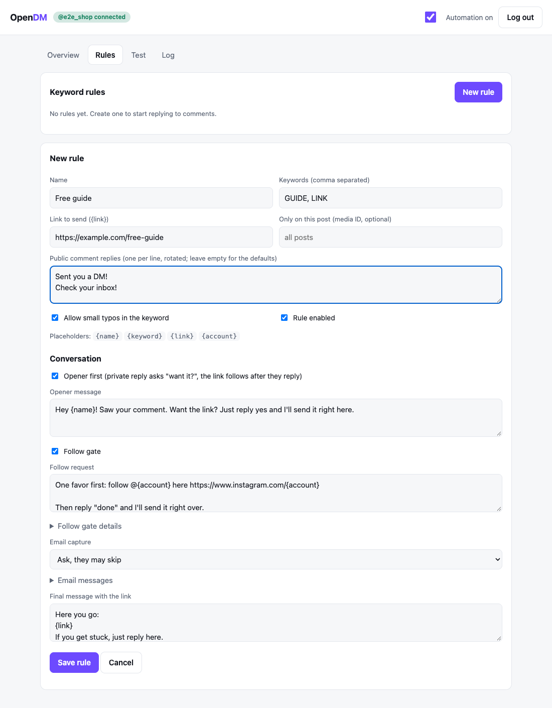
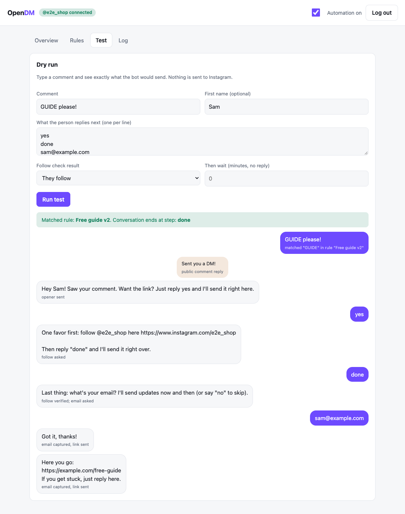

# OpenDM

**An open-source, self-hosted alternative to ManyChat-style Instagram comment-to-DM automation.**
Someone comments a keyword on your post, OpenDM replies to the comment, slides into their DMs with a private reply, optionally asks them to follow you, optionally collects their email, and sends the link. It runs on your own Cloudflare account (Workers + D1), so there is no per-contact pricing and your data stays yours.

[](https://deploy.workers.cloudflare.com/?url=https://github.com/charanjit-singh/opendm)


OpenDM is not affiliated with, endorsed by or sponsored by ManyChat or Meta. "Instagram" is a trademark of Meta Platforms, Inc.

## What it does

- **Keyword rules.** Comment contains `GUIDE` (case, accents, emoji and small typos ignored) and the rule fires. Optionally limit a rule to one post.
- **Private reply + public reply.** The opener goes out as an Instagram private reply to the comment, plus a rotating public comment reply ("Sent you a DM!").
- **A DM flow you can edit.** Opener ("Want the link?") then, on their reply, an optional **follow gate** (checks `is_user_follow_business` through the API; when Meta won't say, it falls back to "tap done") with a **timeout fallback** (no answer after N minutes: the link is sent anyway), an optional **email capture** (optional or required), then the link.
- **Placeholders.** `{name}` `{keyword}` `{link}` `{account}` in every message.
- **Safe sending.** Rolling hourly send cap (default 150, configurable), a queue in D1 for anything over the cap, retry with backoff for transient Graph errors, dedupe of retried webhooks, token-error detection.
- **Admin dashboard** (password protected): connect the account (paste a token or "Connect with Instagram" OAuth), edit rules and messages, **dry-run tester** (simulate a whole conversation without sending anything), event log, on/off switch.
- **Self-contained.** One Worker, one D1 database, one cron trigger. The schema is created automatically on first request. Tokens are encrypted at rest (AES-GCM) and refreshed automatically before the 60 days run out.

| Rules and conversation editor | Dry-run tester | Event log |
| --- | --- | --- |
|  |  |  |

## One-click deploy

1. Click **Deploy to Cloudflare** above. Cloudflare forks the repo to your GitHub, creates the D1 database, and asks for four secrets:

   | Secret | What to put |
   | --- | --- |
   | `ADMIN_PASSWORD` | A long password for the dashboard |
   | `SESSION_SECRET` | Random string, 32+ chars (`openssl rand -hex 32`). Signs the login cookie and encrypts stored tokens |
   | `VERIFY_TOKEN` | Any string you choose. You paste the same string into Meta's webhook form |
   | `INSTAGRAM_APP_SECRET` | The Instagram app secret from your Meta app (step 2 below) |

   If you don't have the Meta app yet, put a placeholder for `INSTAGRAM_APP_SECRET` and replace it later with `npx wrangler secret put INSTAGRAM_APP_SECRET`.
2. Open `https://<your-worker>.workers.dev/admin`, log in, and continue with the Meta setup below.

## Meta / Instagram setup

OpenDM uses the **Instagram API with Instagram Login** (no Facebook Page needed). You need an Instagram **Professional** account (Business or Creator).

1. Go to [developers.facebook.com/apps](https://developers.facebook.com/apps) and **Create app**. Use case: *Other*, type: *Business*.
2. In the app, add the **Instagram** product, then open **API setup with Instagram login**.
   - Copy the **Instagram app secret**. This is `INSTAGRAM_APP_SECRET` (and the OAuth client secret). Copy the **Instagram app ID** if you want the OAuth button (set it as a plain variable: `npx wrangler secret put INSTAGRAM_APP_ID`).
   - **Add account**: add your Instagram professional account (it is added as an Instagram tester while the app is in development mode; accept the invite in Instagram under *Settings, Website permissions, Apps and websites, Tester invites*).
   - **Generate token** for that account and grant the permissions. Paste the token in OpenDM's *Overview, Instagram account* box. (Or use **Connect with Instagram** if you set `INSTAGRAM_APP_ID` and added `https://<your-worker>.workers.dev/admin/oauth/callback` under *Business login settings, OAuth redirect URIs*.)
3. **Configure webhooks** on the same page:
   - **Callback URL**: `https://<your-worker>.workers.dev/webhook`
   - **Verify token**: your `VERIFY_TOKEN`
   - Subscribe to the **`comments`** and **`messages`** fields. Then in OpenDM click **Subscribe to comments + messages** for the connected account.
4. Create a rule in OpenDM, use the **Test** tab to preview it, and comment the keyword from a second Instagram account (one that is a tester/role on the app).

Permissions used: `instagram_business_basic`, `instagram_business_manage_comments`, `instagram_business_manage_messages`.

### Going live (App Review)

In development mode the app only works for accounts with a role on it, which is enough to run it on your own account. To serve comments from the public:

- Switch the app to **Live** (needs a privacy policy URL: use `https://<your-worker>.workers.dev/privacy`, and a data-deletion contact).
- Request **Advanced Access** for the three permissions above through **App Review** (screencasts of the comment, private reply and DM flow; Meta usually also wants **Business Verification** of the company that owns the app).
- Keep to Meta's rules: only message people who commented or messaged you, don't send promotional spam, honor opt-outs.

### Platform limits to know about

- **One private reply per comment**, only within **7 days** of the comment. Because a private reply can't carry buttons or follow-ups, OpenDM sends a short opener and continues once the person replies (which opens the 24-hour messaging window).
- After the person's reply you have **24 hours** to send messages. The follow-gate timeout fallback fires well inside that.
- People who don't follow you get the DM in **message requests**. The default public replies tell them to look there.
- The **follow check** (`is_user_follow_business`) is only returned when Meta allows it for the user. When it is missing, OpenDM trusts "done".
- Meta throttles accounts that send too fast. The hourly cap and outbox exist for that; keep the default unless you know your limits.

## Self-hosting without the button

```sh
git clone https://github.com/charanjit-singh/opendm && cd opendm
npm install
npx wrangler deploy            # creates the D1 database automatically
npx wrangler secret put ADMIN_PASSWORD
npx wrangler secret put SESSION_SECRET
npx wrangler secret put VERIFY_TOKEN
npx wrangler secret put INSTAGRAM_APP_SECRET
```

The database schema is applied automatically on the first request. If you prefer explicit migrations: `npm run db:migrate:remote`.

Local development:

```sh
cp .dev.vars.example .dev.vars   # fill in
npm run dev                      # http://localhost:8787/admin
```

To receive real webhooks locally, expose the dev server with `cloudflared tunnel --url http://localhost:8787` and use that URL as the callback.

### Configuration

| Name | Kind | Purpose |
| --- | --- | --- |
| `ADMIN_PASSWORD` | secret | Dashboard login |
| `SESSION_SECRET` | secret | Cookie signing + token encryption |
| `VERIFY_TOKEN` | secret | Meta webhook verification handshake |
| `INSTAGRAM_APP_SECRET` | secret | Verifies `X-Hub-Signature-256` on every webhook; OAuth client secret |
| `INSTAGRAM_APP_ID` | optional | Enables the OAuth "Connect with Instagram" button |
| `GRAPH_BASE`, `OAUTH_BASE` | optional | Point the Graph client at a mock (used by the tests) |

Everything else (rules, messages, on/off, hourly cap) lives in D1 and is edited in the dashboard.

## How it works

```
Instagram ──webhook──▶ POST /webhook (signature checked, answered 200 immediately)
                         │  comment ─▶ match rule ─▶ private reply (+ public reply)  ─┐
                         │  DM      ─▶ flow state machine (opener/follow/email/link) ─┼─▶ send queue ─▶ graph.instagram.com
cron (every minute) ─▶ drain outbox, follow timeouts, token refresh, housekeeping ────┘
```

- `src/flow.ts` is the conversation as a pure state machine (no I/O), shared by live DMs and the dashboard dry run.
- `src/queue.ts` rate-limits, queues and retries every Graph call.
- `src/engine.ts` turns webhook events into actions. `src/admin.ts` + `src/ui.ts` are the dashboard API and page.
- D1 tables: `rules`, `conversations`, `events`, `processed` (dedupe), `sends` (rate window), `outbox`, `settings`.

## Security

- Webhooks without a valid `X-Hub-Signature-256` (HMAC-SHA256 of the raw body, constant-time compare) are rejected with 401.
- Dashboard: password login, signed HttpOnly SameSite=Strict cookie, JSON-only writes (CSRF), lockout after 10 bad attempts per 15 minutes.
- Access tokens are encrypted in D1 and never returned by the API or written to the log.

## Tests

```sh
npm install
npm run typecheck
npm test              # 120+ unit/integration tests inside the real Workers runtime (workerd), Graph API mocked
npm run test:e2e      # wrangler dev + a local mock Graph API: posts signed webhooks, asserts the outgoing Graph calls
npm run test:browser  # Playwright + Chrome: logs in, connects, creates a rule, dry-runs it, reads the log (writes docs/*.png)
npm run test:all      # all of the above
```

The browser test uses your installed Google Chrome (`playwright-core`, no browser download). CI runs everything on every push (`.github/workflows/ci.yml`).

## License

Copyright (C) 2026 SS Enterprises.

OpenDM is free software under the **GNU Affero General Public License v3.0 or later** (see [LICENSE](LICENSE)). If you modify it and run it as a network service, the AGPL requires you to offer your users the source of your modified version.
