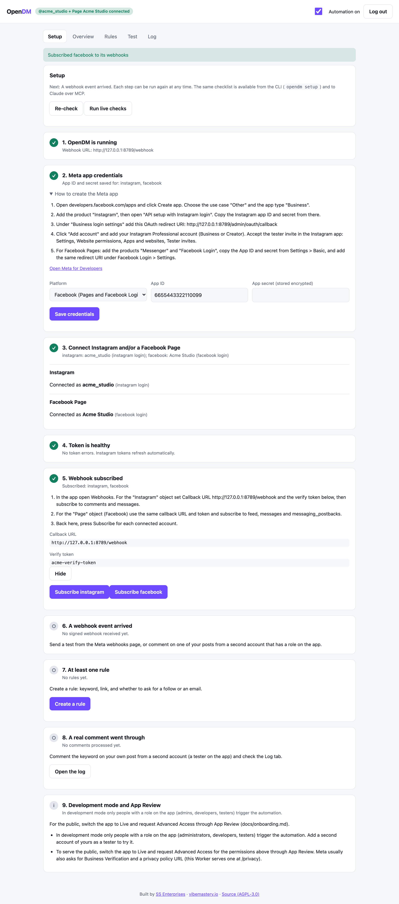

# Onboarding: from zero to live

Getting Meta's credentials is the hardest part, so OpenDM has a **Setup** tab with a live checklist, the same checklist in
the CLI (`opendm setup`), and the same steps as MCP tools for Claude and other agents. Every step can be re-run.



## The checklist

| # | Step | Done when | Who |
| --- | --- | --- | --- |
| 1 | OpenDM is running | the three Worker secrets are set | you / an agent |
| 2 | Meta app credentials | App ID and secret saved (stored encrypted in D1) | a person creates the app |
| 3 | Connect Instagram and/or a Facebook Page | an account is connected | a person authorizes |
| 4 | Token is healthy | no token errors (Instagram tokens refresh automatically) | automatic |
| 5 | Webhook subscribed | callback saved in Meta and Subscribe pressed | person + agent |
| 6 | A webhook event arrived | a signed event reached the Worker | a person triggers it |
| 7 | At least one rule | an enabled rule exists | you / an agent |
| 8 | A real comment went through | a comment was processed | a person comments |
| 9 | Dev mode and App Review | informational | a person |

## 1. Deploy

Use the Deploy to Cloudflare button, or `npx wrangler deploy` (see the README). Set `ADMIN_PASSWORD`, `SESSION_SECRET` and
`VERIFY_TOKEN`. Open `https://<your-worker>.workers.dev/`, log in; the Setup tab opens by itself on a first run.

## 2. Create the Meta app

You need an Instagram **Professional** account (Business or Creator) for Instagram, and a Facebook **Page** you manage for
Facebook.

1. Go to <https://developers.facebook.com/apps> and click **Create app**. Use case **Other**, app type **Business**.
2. **Instagram:** add the product **Instagram**, open **API setup with Instagram login**, and copy the **Instagram app ID** and
   **Instagram app secret**.
   - Under **Business login settings** add the OAuth redirect URI shown in the Setup tab
     (`https://<your-worker>/admin/oauth/callback`).
   - **Add account**: add your Instagram professional account. In the Instagram app accept the invite:
     Settings, Website permissions, Apps and websites, Tester invites.
3. **Facebook:** add the products **Messenger** and **Facebook Login**. Copy the **App ID** and **App secret** from
   Settings, Basic, and add the same redirect URI under Facebook Login, Settings.
4. In OpenDM's Setup tab, step 2, enter the App ID and secret (once for Instagram, once for Facebook; they may be the same
   app or two apps).

### Permissions

| Login | Permissions |
| --- | --- |
| Instagram Login | `instagram_business_basic`, `instagram_business_manage_comments`, `instagram_business_manage_messages` |
| Facebook Login (Pages and Messenger) | `pages_show_list`, `pages_manage_metadata`, `pages_messaging`, `pages_read_engagement`, `pages_manage_engagement` |
| Instagram through a Facebook Page | the Facebook ones plus `instagram_basic`, `instagram_manage_comments`, `instagram_manage_messages` |

The OAuth buttons request exactly these. Meta's current names are listed at
<https://developers.facebook.com/docs/permissions>.

## 3. Connect

In Setup, step 3 use **Connect with Instagram** / **Connect with Facebook** (OAuth). The Instagram token is exchanged for a
60-day token and refreshed automatically; the user id and username are detected. For Facebook you are asked which Page to
connect when the login can see several; the Page token does not expire, and the Page's linked Instagram account is picked up
so Instagram also works through Facebook Login if you prefer that path.

Prefer tokens? Open **Paste a token instead**: an Instagram token (Meta app, Instagram Login, API setup, Generate token) or a
Facebook user/Page token.

## 4. Webhook

In the Meta app open **Webhooks**:

| Object | Callback URL | Verify token | Fields |
| --- | --- | --- | --- |
| Instagram | `https://<your-worker>/webhook` | your `VERIFY_TOKEN` | `comments`, `messages` |
| Page (Facebook) | the same | the same | `feed`, `messages`, `messaging_postbacks` |

The Setup tab shows both values (the verify token is hidden until you press Show). Then press **Subscribe** for each connected
account. **Run live checks** asks Meta whether each token works and which fields are subscribed.

## 5. Test it

Comment the keyword on one of your posts **from a second account that has a role on the app** (administrator, developer or
tester). Check the **Log** tab. Step 6 turns green when any signed event arrives, step 8 when a comment is processed.

## Development mode and App Review

In development mode only people with a role on the app trigger the automation. To serve everyone: switch the app to **Live**
(needs a privacy policy URL: `https://<your-worker>/privacy`) and request **Advanced Access** for the permissions above
through **App Review**, with a screencast of the comment, private reply and DM flow. Meta usually also asks for **Business
Verification**. Allow time for review.

## From a terminal or an agent

```sh
export OPENDM_URL=https://<your-worker>.workers.dev OPENDM_TOKEN=<admin password>
node cli/opendm.ts setup                      # interactive walkthrough
node cli/opendm.ts setup status --json        # checklist; exit code 2 = a person has to act
node cli/opendm.ts setup credentials --platform instagram --app-id ID --app-secret SECRET
node cli/opendm.ts setup oauth-url --platform facebook
node cli/opendm.ts setup exchange --platform instagram --token TOKEN
node cli/opendm.ts setup facebook --token USER_OR_PAGE_TOKEN [--page-id ID]
node cli/opendm.ts setup subscribe --platform facebook
node cli/opendm.ts setup test                 # live checks + a dry run, nothing is sent
```

Every command works non-interactively, is safe to repeat, and returns JSON with `--json`. MCP equivalents:
`opendm_setup_status`, `opendm_set_app_credentials`, `opendm_get_oauth_url`, `opendm_exchange_token`,
`opendm_connect_facebook`, `opendm_select_facebook_page`, `opendm_get_webhook_details`, `opendm_subscribe_webhooks`,
`opendm_setup_checks`, `opendm_send_test`. See [ai-agents.md](ai-agents.md).

## Troubleshooting

| Symptom | Cause and fix |
| --- | --- |
| "Invalid OAuth redirect URI" / "URL blocked" | The redirect URI in the Meta app must match exactly: `https://<your-host>/admin/oauth/callback`, with no trailing slash. Add it under Instagram **Business login settings** and Facebook Login **Valid OAuth Redirect URIs**. After a custom domain, add the new one. |
| "OAuth state invalid or expired" | The round trip took over 10 minutes, or you opened the link in a browser where you are not logged in to the dashboard. Start again from the Setup tab. |
| "Code exchange failed" | The App ID or secret saved in step 2 is wrong or belongs to another app. Re-save them. |
| "(#10) Application does not have permission" / error code 200 to 299 | A permission is missing or not approved for that person. In development mode the person needs a role on the app. Re-connect so the token carries the permissions. |
| Webhook "verify token mismatch" / "Callback verification failed" | The token in Meta differs from `VERIFY_TOKEN`. Show it in the Setup tab, paste it exactly. |
| Webhook verifies but nothing arrives | You did not subscribe the fields (Instagram: comments, messages; Page: feed, messages, messaging_postbacks), or the account is private (comment webhooks need a public account), or you are in development mode and the commenter has no role on the app. |
| Webhook events return 401 in the Worker log | The App secret saved in step 2 does not match the app that sends the webhook (Instagram app vs Facebook app). Save the secret for the right platform. |
| "Invalid OAuth access token" / code 190 | The token expired or was revoked. Reconnect from Setup. Instagram tokens refresh automatically only while the Worker runs and the token is valid. |
| Private reply fails with a "cannot reply" error | Meta allows one private reply per comment, within 7 days. The log shows the reason. |
| People do not see the DM | Non-followers receive it in message requests; the default public replies say so. |
| Instagram messages do not arrive | In the Instagram app: Settings, Messages and story replies, Message controls, Connected tools, **Allow access to messages**. |
